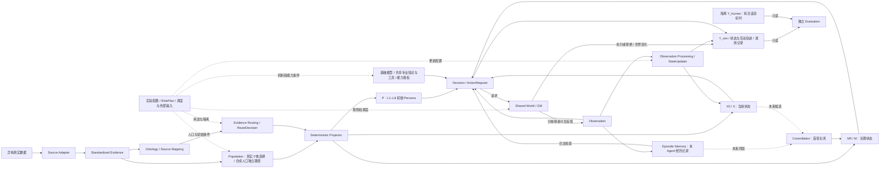

# Architecture Spec：智能行为认知实验基础设施与运行边界

版本：1.2.1｜优先级修订：2026-10-01｜实验优先级与首个实验设计：Designed / Frozen in Spec；代码能力与运行验证分别标记。

本文件只维护系统结构、状态归属与运行职责。证据及投影规则见 [Data Contract](Data_Contract.md)，研究与实验安排见 [Experiment Spec](Experiment_Spec.md)。历史 [Architecture Spec v1](../02_agent_world/Architecture_Spec_v1.md) 原位冻结，用于复现既有选择产物，不再作为当前维护入口。

本次依据用户 2026-10-01 的要求，仅同步实验优先级与首个实验设计，保留 v1.2.1 总体架构、科学定位、统一证据状态、同调用因果限制和 Phase I 分层验收。不修改代码、配置、Data Contract、研究日志、Persona 或历史产物，不执行 Python、测试、模拟或 API。2026-09-20 的 L1–L8、数据授权、状态归属及初始化边界继续有效。文档版本不等于 AgentState Schema 或已验证运行版本；当前状态和历史实验的适用范围由 Experiment Spec 导航。

## 1. 范围与证据等级

工程项目沿用 **Data-Grounded Adaptive Social Agent Framework（真实数据驱动的自适应社会 Agent 框架）**。科学定位调整为：建设能够开展**智能行为认知（Intelligent Behavior and Cognition）研究的 Agent–World 行为实验基础设施**。Behavior 是主要观测对象：Agent 在什么信息与机会条件下请求了什么、实际执行了什么，以及行为如何随经历和反馈变化。社会规范保留为核心研究方向；首个正式科学实验暂定为 Prior Social Behavior → Subsequent Behavior，第一阶段不以“让多个 Agent 自然形成规范”为直接目标。

社会惯例与社会规范是重点方向；框架同样容纳合作、冲突、关系网络变化、共同创造、制度性行为、行为漂移以及未形成稳定模式的结果。不预设必须出现统一规范，不通过 World 规则、提示词或 Evaluation 把期望的宏观结果写进运行过程。模型塔保留基础常识、专业能力、个体表示的分层思想，不要求多套并行 LLM；P/M/X 也属于同一个 Agent。

本次定位是用户确定的项目研究选择，不追溯性地改写为导师新增要求或论文已经证明的结论。模型塔提供分层概念启发，不证明本项目接口或人类认知机制。原 RQ1–RQ4 的历史语义及新路线映射保留在 Experiment Spec；阶段门槛替代“框架建成即直接检验全部拟真问题”的安排。正式申报题目不在本轮自动更改；若学校或导师仍要求真人拟真主实验，需要另行确认交付范围，而非用工程结果替代。

### 1.1 Behavioral Science 方法论

研究主线为：可实验的 Agent–World → 发现行为现象 → 提出竞争性机制解释 → 控制实验与机制干预 → 行为证据 → 将已识别机制重新放回多人世界 → 群体动力学，即 **Simulation → Behavioral Science → Mechanism → Collective Science**。

- **Behavioral similarity ≠ Mechanistic identity**：相似行为不证明内部机制相同，也不证明真人心理机制被复现。
- **Model self-report ≠ Mechanistic evidence**：X 中的 judgment、expectation、intention 是带来源的内部解释记录／待验证解释变量，不因字段存在或模型写出理由就构成机制证据。当前结构化 judgment/intention 也不等于已实现独立 expectation 测量。
- 候选机制须面对竞争解释，例如资源可行性、行动前置条件、信息显著性、提示措辞、检索可达性与随机输出。受控干预的行为效应先限定于该模拟系统；状态变化与行动相关不自动证明中介关系。
- 社会行为研究链为 **Observation → Cognition → Action → Feedback → Adaptation → Collective Pattern**。它是研究框架，不表示每次运行都已发生学习或形成规范。规范形成、冲突、局部规范、消退及完全没有稳定规范均是合法结果。

### 1.2 三种研究模式

| 模式 | 环境与用途 | 能得出什么／不能得出什么 |
| --- | --- | --- |
| Discovery Mode | Rich Community World 作为 Naturalistic / Discovery Environment，寻找行为现象与反例 | 建立现象目录和竞争假设；不是直接的唯一规范因果实验，也不因丰富而具有现实生态效度 |
| Hypothesis-testing Mode | 与丰富社区并存的 Minimal Experimental Scene，控制世界与信息条件、进行干预 | 估计特定操作化条件的行为效应；不由 X 的自报单独证明机制或人类机制同一性 |
| Collective Dynamics Mode | 将在受控实验中获得支持、且明确适用范围的微观机制放回多人持续互动 | 研究群体模式及失效边界；不预设合作、规范或一致性必然出现 |

三种模式是目标接口与实验组织方式，不是宣称现已实现三套运行模式。Phase I 首先验证共用基础设施，之后才分别承担发现、机制检验和群体研究任务。

当前冻结的优先顺序为：**Phase I-A Offline/Static Validation → Phase I-B Runtime Closed Loop → Phase I-C Behavioral Trace Reconstruction → Minimal Behavior Experiment: prior behavior → subsequent behavior → competing mechanism experiments → longitudinal interaction → structural/group experiments**。它细化既有四阶段路线，不重定义总体架构：Phase II 先做最小行为效应实验；Phase III 区分竞争机制；之后先纵向互动，再推进结构／群体实验。Rich Community 的发现模式继续保留，但不是首个科学实验的必经前置运行。原 descriptive / normative social-information experiment 保留并后移至机制区分阶段。

首个实验的完整冻结约束见 Experiment Spec 第 2.2.1 节：主要比较 **C1 Partner-help vs C2 Matched non-social gain**，C0 仅为低资源描述性参考；目标决策时匹配 A 可获得的全部决策相关客观状态，包括 B 的可见／可推断资源与需要状态。B 的前序帮助属于脚本实验操纵，不是自主决策；主要结果为 GM 实际执行后的 ActionResult。Persona 作 blocking／heterogeneity factor，P 冻结、M disabled/frozen，各 trial 独立重置且无 carry-over。行为效应不直接证明 reciprocity、gratitude 或 norm internalization；具体工程实现本轮不决定。

### 1.3 统一能力／证据状态等级

统一使用 **Designed → Implemented → Engineering Validated → Behaviorally Validated → Mechanistically Supported** 描述证据递进，明确 **Implementation ≠ Behavioral Effect ≠ Mechanistic Evidence**。箭头不表示自动升级，也不是要求每个研究构念都独立实现为代码模块。

| 状态 | 含义与最低证据边界 |
| --- | --- |
| Designed | 接口、构念或实验设计已定义；不表示代码存在、实验已实施或假设成立 |
| Implemented | 已有代码实现；不表示能正常运行，更不表示已出现行为效应 |
| Engineering Validated | 在指定版本、配置和预先声明的范围内，通过相应工程验收；不能外推到未覆盖能力或完整 Phase I |
| Behaviorally Validated | 在预定义行为实验中观察到稳定、可重复的行为效应；限定行为、任务、模型和环境，不自动等于真人效度或机制证据 |
| Mechanistically Supported | 通过干预、消融、时间分离、模型比较等适当方法获得支持某种机制解释、区分竞争解释的证据；仍有假设和适用范围，不使用绝对的 Mechanistically Proven/Validated |

标记须写清对象、所支持的主张、版本／配置／任务范围及证据位置；未适用的等级不强行填写，缺证据不得从较低等级推定较高等级。Not demonstrated／Not validated 是当前证据缺失说明，不等于已证明不存在。代码更新后，旧版本的验收状态不自动继承。

| 当前代表对象 | 状态示例 |
| --- | --- |
| Context Builder | **Implemented / not yet Engineering Validated**；继续保留 `implemented / not runtime-validated`，待 Phase I-A 起步验收，不声称长上下文已解决 |
| MemoryAccessPolicy | **Implemented / not yet experimentally compared**；接口及默认 bounded-relevant 已实现，其余独立比较条件未实现／未比较 |
| 实验优先级与首个 Prior Social Behavior → Subsequent Behavior 设计 | **Designed / Frozen in Spec**；不是 Implemented、Engineering Validated、Behaviorally Validated 或 Mechanistically Supported |
| N2 / N3 | **Designed research constructs / not Behaviorally Validated**；描述性／规范性预期不是已验证模块 |
| N4 internalization | **Designed future construct**；不因记录经历或持续选择就升级为内化证据 |
| norm formation | **Not demonstrated** |
| human behavioral fidelity | **Not validated**；须有独立外部效度证据 |

## 2. 完整架构、八部分及控制关系

下图表示逻辑关系，不表示全部模块已经实现。初始化链按 Data Contract 执行：异构数据 → Source Adapter → Standardized Evidence → Ontology / Source Mapping → ExperimentRolePlan 的用途门槛 → Evidence Routing / RouteDecision → Deterministic Projector → P/M0/X0。RolePlan 是实验前冻结的用途与信息条件，不要求处理每条数据时重新设计实验。

Population、专业能力、实验控制、记忆记录与运行适配器是围绕八部分提供服务的设施，不增设可绕过权限的顶层状态。合成人口的生成依据与身份须独立标记，图中的共享初始化入口不表示合成属性属于真人 Evidence。Evaluation 没有写回 Agent 或 World 的路径。

| 部分 | 权威内容与写入者 | 生命周期 |
| --- | --- | --- |
| Evidence | 来源事实、缺失、时间与限制；Adapter 追加版本 | 不因模拟修改 |
| P | L1–L8 的数据驱动初始 Persona；初始化 Projector 写入 | 单次 run 完全冻结，属性缺失不填造 |
| M | 长期经验、知识变化、持久关系信念、行为惯例与规范判断；Projector 初始化，Consolidator 才可运行期写入 | M0 候选不等于已巩固；首次闭环冻结 |
| X | 对局部观察和当前情境形成的快速认知状态；Projector 初始化，StateUpdater 更新 | 按已交付观察/合法事件更新，可过期 |
| World | 客观资源、权限、制度与事件；WorldEngine/GM 经验证后提交 | 共享但按视角暴露 |
| Y | 请求、实际行动、拒绝及结果的追加日志；独立封存真人目标 | Y_sim 与 Y_human 隔离 |
| Decision | 只读上下文到 ActionRequest 的编排，不直接改状态 | 每次行动调用 |
| Evaluation | 离线读取目标和模拟日志，产出指标 | 不写回运行中的 Agent/World |

这些是逻辑权限，不要求八个物理进程或八个 LLM。每个状态转换须有事件、规则版本、前后版本及失败记录。Episodic Memory 的记录器只追加本 Agent 可知的经历与行动记录；该历史库既不是共享 World，也不因保存了记录就形成 M。

## 3. P 的完整结构与动态状态

### 3.1 L1–L8 整体属于初始 P

P 是 Agent 初始进入模拟时的数据驱动个体表示。以下是属性分类，不是更新频率的分类，也不意味着来源测量了全部属性。L0 是来源与数据元信息，由证据/provenance 接口承担，不当成人格特征。

当前实验角色为 **Human-grounded individual-difference initialization**：有真实来源且可追溯的个体差异输入，不以“复现这个真人”为既成目标或能力。未来可比较 human-grounded 与 reduced/common 决策初始化条件，但必须另行冻结操纵、保留完整来源 P、不扩大授权；无独立真人行为标签时，只能研究模拟行为分布、异质性和社会敏感性，不能称为个体拟真验证。

| P 内层级 | 概念范围 | 初始表示边界 |
| --- | --- | --- |
| L1 先赋背景 | 出生、成长、家庭与语言背景 | 只保存来源实际支持的范围与时间精度 |
| L2 社会位置与基线资源 | 教育、职业、经济位置、健康及接入资源等基线 | 历史职业不是当前职业；基线资源不是 World 实时账本 |
| L3 知识结构 | 经测量或可靠记录支持的个人知识 | 基础 LLM 或共享知识库的能力不等于个人已知 |
| L4 技能与行动能力 | 经证据支持的技能、资格与能力 | 职业名称或学历不能自动生成技能 |
| L5 相对稳定的心理与价值 | 有测量依据的心理、价值及一般倾向 | 单题态度不自动证明长期人格或跨情境稳定性 |
| L6 初始社会关系与身份 | 来源支持的初始关系、群体身份 | 不凭家庭人数补造关系网络；初始关系不随运行事件改写 |
| L7 社会规范相关的相对稳定机制或学习特征 | 有个人证据支持的机制相关属性 | 学习率、内化程度等未经测量时为 unknown；机制参数也可仍待设计 |
| L8 行为策略倾向 | 有独立证据支持的相对一般策略倾向 | 不把本次行动答案、单题态度或职业刻板印象变成合作概率等参数 |

保留完整层级接口，不要求填满字段；unknown、来源限制及未观测原因按 Data Contract 表示。P 在本次 run 内冻结是运行契约，不是声称这些属性在现实中永久不变。未来研究跨阶段变化时，须有明确规则、新版本 P 和新的阶段/run；原始 P 与 Evidence 保留。

### 3.2 初始基线、运行状态与客观事实

不得将 L1–L8 整体重新拆成分配给 P/M/X 的动态容器。受授权的初始个人属性进入 P 对应层；实验特定的初始长期状态候选 M0 和情境状态 X0 按独立语义及用途初始化，具体路由见 Data Contract。完整 P 结构也不授权复制所有问卷答案或目标载荷。

例如，P 保存有时间标注的基线就业或既往职业，运行中就业变化由 World 事件及可见信息进入当前 X，P 原值不变；P 的初始关系与 M 中后来形成的关系信念、World 中客观关系事件分开。基线收入档位不转成精确可支出余额；World 处罚机制与 X/M 的感知处罚风险允许不一致。跨状态可引用同一来源或初值，但不能复制为两个独立事实、重复计证，或绕过同次实验的唯一路由。

时间合同以 Data Contract 为准：区分记录时刻、参考时期、入库时刻、模拟时钟和有效区间。历史快照不能自动充当现在，时间对齐由实验冻结。

### 3.3 World Event、Observation、Episodic Memory、X、M

| 对象 | 表示什么 | 不能自动等同于 |
| --- | --- | --- |
| World Event | 世界客观发生的事件 | 所有人已获知 |
| Observation | 经可见性处理、实际交付给某 Agent 的信息 | 该 Agent 相信信息为真 |
| Episodic Memory | 该 Agent 收到的观察、经历和自身行动记录，保留关联 ID | 长期信念或规范内化 |
| X | 对当前观察的短期判断、预期、感知规范及情境状态 | 永久知识或 World truth |
| M | 经过积累/巩固的长期知识、经验、关系信念、惯例和规范判断；M0 初始候选另标 | 原始经历列表或已证实的真人心理状态 |

观察到某伙伴三次选择 A 是经历记录；“伙伴偏好 A”是判断；“成员应该选择 A”又是规范性判断，需分别表示及追溯。Episodic Memory 可被合法检索供 Decision/StateUpdater 使用，但检索同一事件不会新增独立支持。保存历史不等于开启长期学习。

Observation 经处理更新 X；运行中新增/修订 M 必须由独立 Consolidator 提交。其输入预留合法经历、X 的历史及支持/反证；输出预留带来源与前后版本的 M 更新或不更新决定。来源去重、独立性、巩固条件、时间窗口、衰减、更新上限、冲突与遗忘策略仍待设计/验证，不沿用旧日志阈值。首轮关闭该机制。

## 4. 决策、权限与 Concordia

1. ObservationBuilder 仅向指定接收者发布可见信息；GM 的完整 World 视图不可直接进入 Decision。
2. StateUpdater 根据已交付的 Observation 更新 X。模型返回的 judgment/intention 是候选报告，经独立 CognitiveUpdater 校验引用及允许路径后写 X；不是 Decision 自行写状态。行动输出另为 ActionRequest，由 GM 决定是否执行。固定版本的授权决策视图与本地完整研究状态分离，Decision 不得直接改 P/M/X 或 World。
3. GM/handler 对请求的主体、参数、权限、资源和世界版本进行验证；拒绝仍生成 ActionResult 和日志。请求不等于执行。
4. 已接受行动的 World 转移与 ActionResult/Y_sim 应事务性提交或可恢复地关联；request_id 使重试幂等。可见后果经 Observation 再影响 X。
5. 所有错误显式记录，不伪造成功或静默跳过。首次 vertical slice 设 `learning_enabled=false`：P/M 运行期冻结，X 可更新；未来开启学习时 Consolidator 只能写 M。
6. 多 Agent 运行按已固定的调度规则产生请求和可见反馈，各 Agent 持有自己的状态与经历。行动顺序、冲突/并发处理及外部事件须留记录；具体调度方式待实验决定。框架支持多个自主 Agent 的重复互动，首轮一个 Agent 加脚本角色/固定事件只是工程测试范围。

Concordia 是候选运行基础设施，应通过适配器承接上述接口；其现成功能不定义本项目的能力上限。现有原型不因采用此设计就满足这些要求。Riverbend 等旧项目未来可选择性复用，本轮不审计或改造，也不为旧兼容改变当前边界。

### 4.1 当前 Context Builder：implemented / not runtime-validated

状态依据为用户本轮同步及上一轮代码修改记录，不是本轮重新执行或验证代码。统一 `context_builder.py`、可替换 `MemoryAccessPolicy`、event/request ID 去重、分项预算审计及冻结输入的 `PreparedDecision` 已写入代码，**尚未运行 Python、测试、模拟或 API**。归入 Phase I 的待运行验证基础设施，不再列为“重新设计／从头开发 Context Builder”，也不能写成“已经解决长上下文问题”。

本地保留完整 P/M/X、原始 Observation、经历、任务历史和审计信息；模型读取当前授权的决策视图。当前 Observation 与必需新事件、反馈不得被预算适配静默删除，授权 Persona 不得偷偷裁剪；仅可按已记录策略选择可选旧经历。同 ID 不同载荷须显式失败；预算仍不足则停止该调用，不伪造摘要、不改用 WAIT。

默认仅实现 `BoundedRelevantPolicy`。`context.memory_policy.adapter/options` 和 `MemoryAccessPolicy.select` 为未来 no episodic retrieval、recency、relevance、fuller-history 条件保留接口；这些独立比较条件尚未实现。无历史检索不等于屏蔽本轮合法新交付，也不等于 M 被清空。工程检索／预算裁剪今后可能成为实验操纵：必须记录策略、版本、选择／移除项和实际输入，不能把不同有效暴露量伪装成同一信息条件。

分项审计至少区分 Persona/P、M、X、current Observation、必需补交信息、episodic retrieval、task/intention view、system/instructions/action schema；并关联完整拟发送／实际发送 messages、估算方法、预留量、上限、哈希和供应商实际 usage。默认 UTF-8 字节预留代理不是精确 Token 数；可选本地 tokenizer 接口也未验证与供应商分词一致。不得从字符／字节数推断模型已经实际超限。

### 4.2 调度与开放行动的能力限制

当前社区继续使用同步阶段：观察 → 独立决策 → 收齐请求 → GM 统一结算 → 定向反馈。Runner 与 GM 仍有全员阶段约束，不能将其描述为已经可替换的通用异步调度。未来时间推进、Agent 激活、持续行动、事件触发及并发冲突策略应可替换，并记录发生／交付／生效时间；完整异步引擎、连续虚拟时间、空间移动及个人日历尚未实现／验证，本轮不开发。

当前 OPEN 为 **有限开放行动解释**：自然语言表达不等于任意世界行动可执行。保留未来解释器与受约束结算分离的方向；生成式 GM 尚未实现／验证，不得替其他 Agent 决策、凭空改资源、把陈述当事实或越权读私有信息。结构化行动仍经资源、权限与前置条件检查，未覆盖行为应明确记录无法执行原因。更换场景是否无需修改核心 Runner 尚待跨场景运行验证。

### 4.3 cognition report 与 action 同调用的因果限制

**Implemented cognitive states are manipulable experimental representations, not validated cognitive mechanisms.** 已实现的认知状态首先是可追踪、可操纵的实验表征，其机制意义必须通过独立行为实验与干预获得支持；可操纵性是研究接口属性，不表示所有操纵条件已实现。

当前 judgment／intention 报告与 action 可以由同一次模型调用共同输出；即使报告包含 expectation 文字，也不构成独立预期测量。同调用仅提供过程记录、相关关系和候选解释，不能单独支持 **X → Action 的因果中介主张**。例如收到 O 后，同时输出“我预期别人会反对”和行动 A，不能据此声称 normative expectation caused Action A。程序先写 cognition_update 再写 action_request、JSON 字段先后或模型自述的推理顺序，均不能补足这个证据缺口。

Phase III 若要检验 O → X → Action 中 X 的机制作用，必须预先选择至少一种能够提供独立机制证据的设计：认知测量与行动生成时间分离、X 形成后干预 X／可访问状态、expectation state available vs unavailable、受控消融、竞争计算模型比较，或其他能区分相关记录与中介作用的方法。单纯拆成两次调用或建立时间先后本身也不充分，仍须说明如何区分竞争解释及干预副作用。本轮不选定最终方案，不修改代码或增加 API 调用。

## 5. 专业层、规范与 N1–N6

### 5.1 模型塔与能力开放

| 职责 | 内容与边界 | 接口方向 |
| --- | --- | --- |
| 基础模型 | 系统的一般语言、常识和推理能力 | Decision 使用固定模型配置；不是个人知识测量 |
| 共享专业基础设施 | 领域知识、专业模型、Skill/Tool 的版本化目录 | 接受受控检索/调用，返回有来源及作用域的结果 |
| 个体知识与技能 | P/L3、P/L4 及职业/资格/经历证据；运行中新知识可在 X/M | 向能力判断提供已授权、带时间与限制的最小视图 |
| 实际可用能力 | 依据个体证据、能力授权及合法环境条件确定开放范围 | 生成该 Agent 的 CapabilityView，记录规则版本、依据与允许/拒绝原因 |
| 客观执行权限 | World/GM 验证行动参数、资源与制度条件 | 将 ActionRequest 接受或拒绝，独立于工具是否可调用 |

专业知识和工具基础设施共享，具体能力允许只向部分 Agent 开放。职业只是授权的候选依据，不自动证明技能、当前任职或许可；历史工程师记录不产生“全部工程技能”。“知道什么”“能做什么”“开放什么工具”“World 允许做什么”各有依据。具体职业—Skill 规则、资格时效和开放条件仍待设计，不在本轮创建映射表。

Skill/Tool 的计算或检索结果可以成为合法输入；涉及世界副作用的调用仍须经过 GM 的行动验证。能力接口不能读取隐藏 World/目标、补造个人技能或自行修改 P。工具选择、输入、实际返回和失败记录进入运行轨迹；个人 knowledge/skill 的证据合同见 Data Contract。

专业知识须有来源、时期、适用群体/领域和版本。Agent 对世界规则的认识只能来自合法发布和观察，不得读取 GM 私有状态。违反规范可以仍然执行并触发社会反馈；仅因“不合规范”而一律拒绝会把规范行为测试变成权限测试。

### 5.2 N1–N6：六类规范相关机制假设

N1–N6 是六类**可研究、可操作化、可消融的机制假设**，不是六个已经存在的规范模块，也不是第九个状态或六套 LLM。P/L7 只保存有个人证据的初始属性；运行判断写 X，长期改变只能经独立 Consolidator 写 M，行动须经 GM。以下只规定构念与未来检验方向，不宣称机制已经成立或测量已冻结；当前 `norm_inference=disabled`、`learning_enabled=false`。

| 机制 | 输入与概念 | 状态/行为接口 | 独立检验方向与边界 |
| --- | --- | --- | --- |
| N1 norm recognition／规范识别 | 合法观察、领域知识及个体状态：情境中有哪些规则/期待 | X 中候选规范及不确定性供 Decision 使用 | 分开检验识别与遵守，识别不保证行动 |
| N2 descriptive expectation／描述性预期 | 可见他人行为/经历：别人通常怎么做 | X 的行为频率预期；长期判断候选与 M 更新分开 | 对照可见历史和预期，不能直接读全群体真值；不是仅凭多数选择认定规范 |
| N3 normative expectation／规范性预期 | 可见赞成、反对、提醒及反馈：别人认为应该怎么做 | X/M 中带群体与情境范围的社会期待候选 | 与行为频率分开测量，多数行动不等于赞成；社会评价不自动等于实际处罚 |
| N4 internalization／规范内化 | 持续支持/反证及个体判断：规范是否进入自身认可 | 未来 M 中可审计的长期判断及 Decision 的持续选择 | 须区别惯例、威慑和认可；单题/单次顺从不证明内化 |
| N5 social learning／社会学习 | 合法来源的观察、经历及有证据的学习特征 | X 判断修订；满足明确条件才由 Consolidator 更新 M | 去重/反证/机制关闭对照；上下文适应不等于长期巩固 |
| N6 norm enforcement／规范执行 | P/M/X 中判断、行动空间与资源 | Decision 请求提醒、反对、奖励或制裁等行动；结果在 Y/World | 分开检验意图、请求、真实执行与反馈；GM 权限拒绝本身不是居民规范制裁 |

这些假设容纳规范的维持、争议、分化、消退和不存在稳定规范。世界事件不自动让所有 Agent 获知、相信或内化。具体计算方法、参数和构念效度仍待研究；生成 judgment/intention 字段不等于启用或验证 N1–N6。

## 6. Population：两条独立路径

Human-grounded 路径选择具有真实个体关联证据的记录；Synthetic/DAG 路径未来根据总体分布及有依据的属性依赖生成明确标记的合成人口。后者的依赖假设不自动是因果关系。两条路径可接入共同的初始化逻辑，但必须传递不同的身份类别、生成/选择依据和限制；具体数据表示见 Data Contract。

总体统计只作为校准或生成约束，不写成某个真人的观察；不同来源缺乏可靠身份关联时不得拼接，当前仍不授权任何跨来源真人合并。不能把合成补值混入真人 P 后声称全部真实。人口规模、构成、异质性、抽样与初始群体/网络结构由实验配置控制。已有 12 人是架构边界样本，不自动是群体涌现研究的代表性人口。本轮只保留接口，不实现人口生成器。

## 7. 实验控制、独立 Evaluation 与复现

### 7.1 实验设施

实验配置在 run 前控制初始人口、Persona 初始化、Agent 机制/能力开放、参数化 Scenario Kernel、World、观察范围、互动网络、行动顺序与外部输入。支持控制组、消融、敏感性分析及多次独立运行；具体假设、条件与数量由 Experiment Spec 冻结。Abstract Repeated Coordination 仅是可发展的情景方向，不限定完整框架的 World 类型。

严格条件比较须控制外部输入。未来外部输入接口可区分固定事件流、保存的外部数据回放与真实动态信号，记录时间、版本及实际交付；动态信号模式的不可控性应进入比较限制。本轮不选择模式或事件参数。

工程复现用于重建一次执行的实际输入、输出和状态；科学重复用于在预定义条件下多次运行，研究结果分布和对条件的敏感性。相同 seed 不保证 LLM 逐字复现；必须保存实际 Prompt、模型响应、工具调用、重试、调度与完整轨迹。使用保存响应回放与重新调用模型属于不同复现方式，须明确标记。运行记录至少关联初始化、模型/数据/代码/规则/配置版本与哈希、状态版本、请求/结果、世界变化及错误；RunManifest 表示要求见 Data Contract。

### 7.2 Evaluation 的只读接口与结论边界

Evaluation 从完整的受控日志、指标定义和实验比较配置读取数据；存在合适的独立真人目标时再读隔离目标，输出诊断、指标、分布、不确定性与探索发现。它不向正在运行的 Agent 或 World 写入评分、目标或“应该形成的规范”。跨 run 的设计调整另立版本，不能悄悄改运行机制。

工程计数与一致性检查之外，增设设计层的 **Behavioral Measurement**：持续性、适应、社会／规范性信息敏感性、意图—行为一致性、异质性、路径依赖、反转／恢复及互动响应。每项必须指定实际行为、可执行机会、信息暴露和所需日志，并说明不能推出的结论；候选定义见 Experiment Spec 第 9 节，尚非已实现评分器。不构造缺乏构念边界的 sociality／morality／norm 单一总分。

| 评价层次 | 支持分析的对象 | 不能替代的证据 |
| --- | --- | --- |
| 个体 | 行动、可见观察、状态变化、持续性与偏离 | 机制效度或真人拟真 |
| 互动 | 信息传播、合作/冲突、反馈、关系与相互影响 | 无控制的相关性不能直接称因果 |
| 群体 | 共同惯例、局部分化、网络与未预期模式 | 趋同不自动是社会规范；无稳定模式也是结果 |
| 实验 | 条件比较、重复运行、消融与稳健性 | 单次现象不能充当稳定结论 |
| 现实验证 | 合适独立真人行为数据下的一致性和适用范围 | 模拟中出现的模式不能直接作社会预测 |

共同惯例须有行为重复/持续的测量；描述性预期须测“认为他人怎么做”；命令性期待须测“认为他人赞成什么”；内化须进一步区分自身认可、威慑与惯例；规范执行须有行动与反馈证据。具体操作化、阈值和测量方案待实验设计，不能以一个趋同率覆盖全部构念。

同时支持预先定义指标和完整日志上的探索性发现，分别标注预注册检验与事后探索，后者可为新实验提出假设。日志中的 E1–E7 保留为领域/政策评价研究积累，未来可作为插件式评价扩展；其旧细节和阈值不是当前通用评价或首轮必选项。

### 7.3 安全与架构验收

Y_human 及语义衍生目标不进入 Projector、Decision、GM、Observation、检索索引、提示词示例或调参反馈。真人敏感证据只按最小必要范围使用，外部模型与回放须遵守来源许可。角色划分与输入许可在实验层冻结，通用数据约束见 Data Contract。

Architecture Validation 检查确定性初始化、追溯、缺失完整性、P 不变、目标隔离、可见性、请求/结果分离、World/log 一致、错误记录与 RunManifest。通过只能称“指定小样本和场景的架构闭环有效”，不能称“Agent 已像真人”。

具体完成标准按 Experiment Spec 第 2.1 节分为 I-A 离线／静态验收、I-B 运行工程验收和 I-C 行为轨迹重建验收。只有三层在预先声明的范围内均通过，才能称 **Behavioral Infrastructure ready for Phase II within the validated scope**。I-A 通过不等于 Phase I 完成；I-C 验证的是轨迹可重建，不是第 1.3 节的 Behaviorally Validated，更不是机制证据。

首个最小行为实验不作为 Phase I 验收条件；其正式科学运行须在 I-A／I-B／I-C 对声明范围全部通过后另行开展，不能为验收要求 Agent 表现出帮助或合作效应。

## 8. 当前工程状态与阶段门槛

状态按具体版本和产物区分，不能把旧版本 completed 转移到新版本。单 Agent S12 协调闭环及 TypeScript 多 Agent 线路是历史架构工作；12 个 Persona 已完成初始化，当前继续复用，不重做来源审计、抽样或投影。

| 分类 | 内容 | 边界与下一步 |
| --- | --- | --- |
| 现有功能 | 真实来源初始化、授权决策视图、Python 社区资源／生活规则、API 与预算日志、P/M 冻结 | 旧社区已有真实运行记录，但不证明新认知版本或长时间运行可靠，也不证明真人效度 |
| 已实现、待运行验证 | Context Builder、MemoryAccessPolicy、ID 去重、分项预算、PreparedDecision；认知／任务及 SceneAdapter 路线 | Context Builder 明确为 `implemented / not runtime-validated`；认知版本此前仅完成第一阶段后失败，不能报整轮通过 |
| 需要修复／核查 | Phase I 的必需交付、预算失败、任务／请求／执行分离、OPEN 的实际效果、跨决策链回读 | 优先在另行授权后补齐离线验收与只读链路检查；依据失败证据修复，不重新设计已有 Builder，不预设必须合作 |
| 已冻结设计、尚未实现 | 实验优先级；首个 Minimal Behavior Experiment：前序伙伴帮助与匹配非社会收益的比较 | Designed / Frozen in Spec；具体约束见 Experiment Spec 第 2.2.1 节，正式运行以 Phase I 全部门槛通过为前提 |
| 未来新增 | behavioral measurement、现象目录；后续 descriptive / normative social-information 条件；独立 memory-access 对照；逐个机制干预 | 后续候选仍需操作化与冻结，不是当前已实现功能；不与首个帮助实验的 C0–C2 混用 |
| 暂不做 | Consolidator／M 学习、RL、Synthetic/DAG、大规模人口／政策评价、完整生成式 GM、地图／异步小镇 | 不能为了展示长期性或群体结果越过阶段门槛；Concordia adapter 也尚未接入 |

当前 P 完全冻结、M 运行期冻结且 `learning_enabled=false`。短期 X 修订和检索后行为变化可作为适应现象研究，不因此称为长期学习。下一项代码任务仅对应 Phase I-A 的 offline validation + read-only behavioral trace readback；本轮不实施。Phase I 的通过须满足 I-A／I-B／I-C，且只支持指定范围的基础设施就绪；不证明无限长期稳定、跨场景通用或完整开放世界能力。Phase II–IV 和独立真人验证均有各自证据要求。

## 9. 扩展接口及与 Experiment Spec 的衔接

下表维护逻辑职责；其中部分已有 Python 接口，具体状态以第 8 节为准，未实现的职责不因被列入表中成为现有能力。

| 接口 | 输入 → 输出 | 稳定边界 |
| --- | --- | --- |
| 来源接入/投影 | 来源 → Evidence；映射、RolePlan、RouteDecision → 初始化状态 | 数据语义与版本遵循 Data Contract |
| Population | 来源内个体引用或总体约束/生成依据 → 带真实/合成身份的初始化输入 | 不伪造真实身份或个人证据 |
| Capability | 合法个人证据视图、能力策略、允许环境信息 → 可用知识/工具及授权依据 | 不赋予 World 执行权，不推断未观测技能 |
| Observation / Episodic Memory | World/自身行动的可见信息 → 定向交付与本 Agent 经历记录 | 不向其他 Agent 泄露私有信息 |
| Context Builder / MemoryAccessPolicy | 本地授权状态、已交付观察、策略及预算 → 冻结决策视图与输入审计 | 已实现、未运行验证；必需新交付与可选历史分开，策略可替换而不扩大数据权限 |
| StateUpdater / Consolidator | 合法观察/经历及已有状态 → X 更新 / 未来 M 更新或不更新原因 | 写入者分离，P 不可写 |
| Decision / GM | 固定状态与能力视图 → 请求 → 验证结果、世界事件与可见反馈 | 请求与结果分离，幂等与事务要求保留 |
| 实验控制 / 运行记录 | 条件、初始人口、机制、世界、调度、外部输入 → 可审计运行轨迹 | 版本冻结；实际 LLM 响应纳入记录 |
| Evaluation | 轨迹、比较/指标定义、可用真人目标 → 分层结果和探索发现 | 只读，不参与世界裁决 |

与 Experiment Spec 的当前边界一致：实验优先级与首个实验设计为 **Designed / Frozen in Spec**，不是实验已实现或已验证；本轮不开始 Phase I-A，不运行或变更实验。后续获准的代码入口仍为 Phase I-A 离线验收与只读行为链回读。现有 12 人、完整 P/L1–L8 与授权视图继续复用；historical RolePlan、选样状态及目录计数保持原义。Data Contract 的来源、时间、目标隔离与新定位没有发现需要改写的实质冲突，本轮不修改该文件。最小场景不等于缩减真实 Persona，独立 Runner 不等于 Concordia adapter，进程内提交不等于持久化恢复；旧 RQ 的真人一致性部分仍需独立验证。行为链的当前日志覆盖与缺口见 Experiment Spec 第 12 节。
